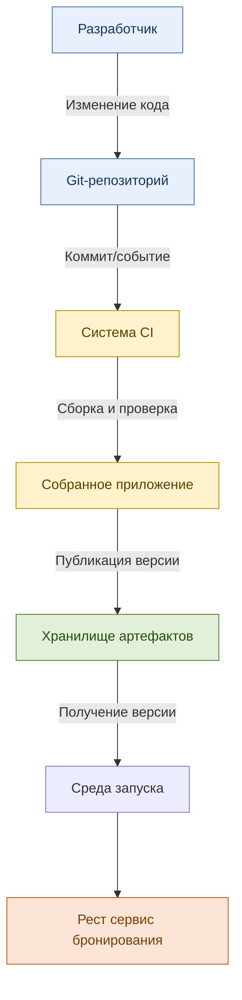
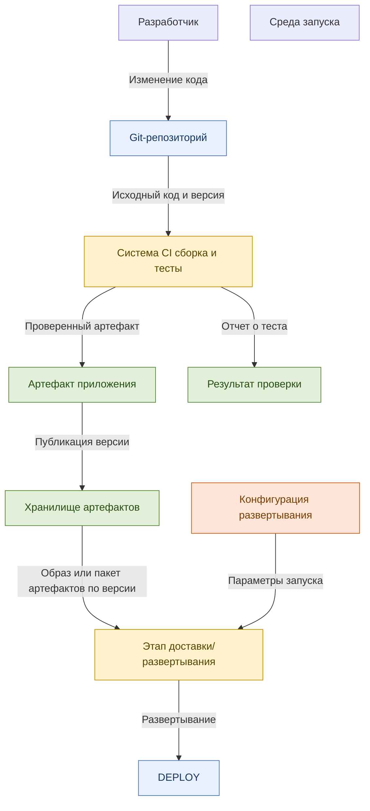
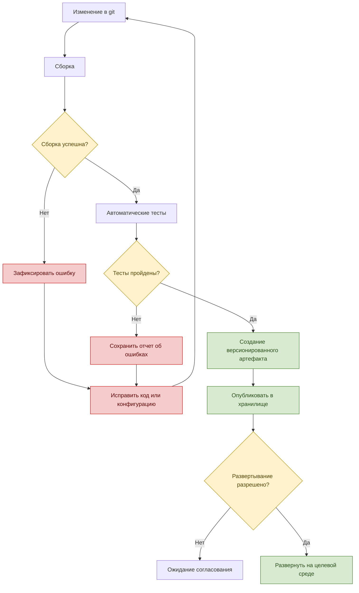
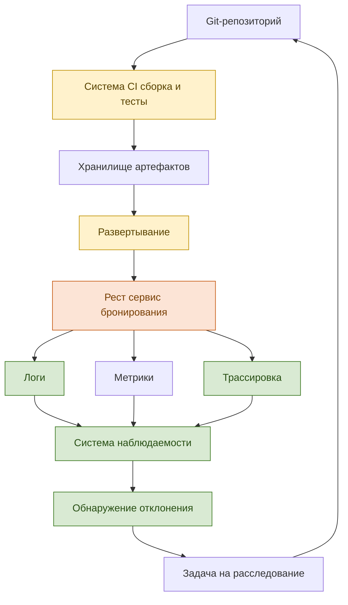
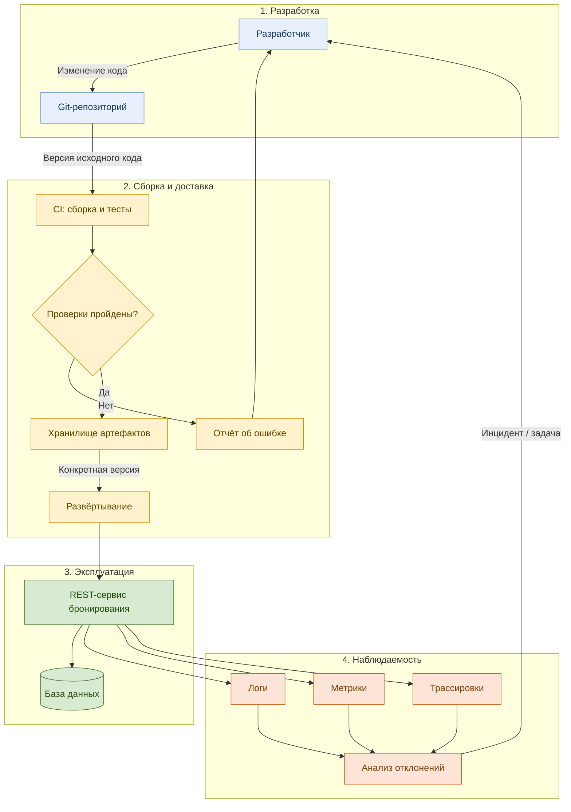

# Основной поток разработки

# Потоки данных и артефакты

# Версионирование и условия выпуска

# Диаграмма наблюдаемости и обратной связи

# Диаграмма разделения по этапам разработки и сопровождения

